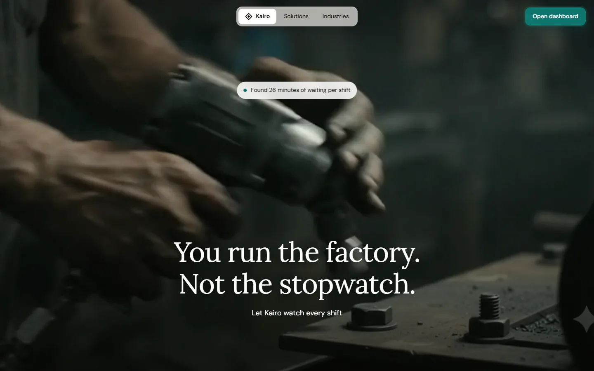
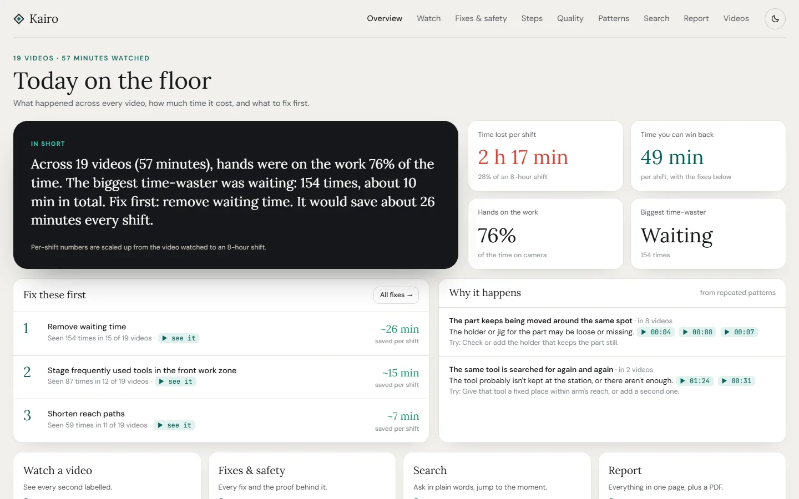
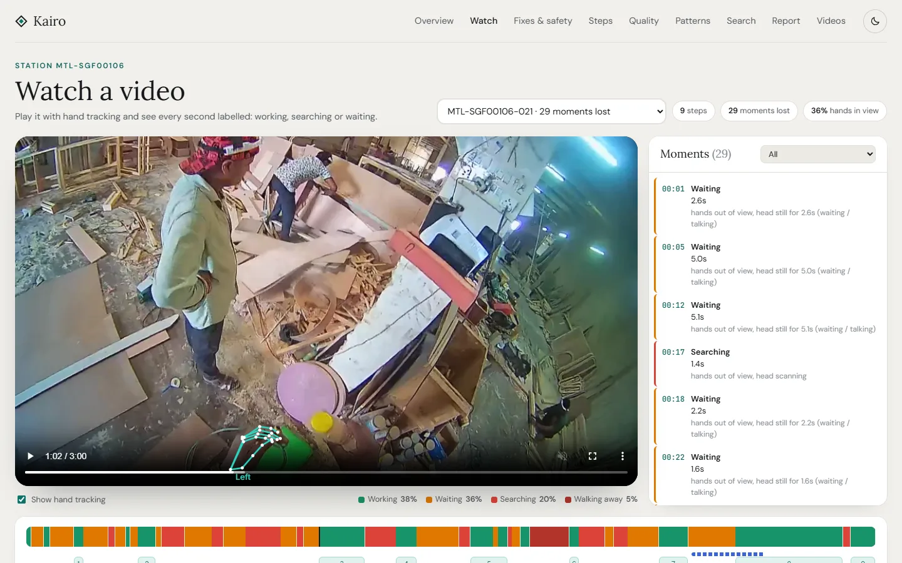
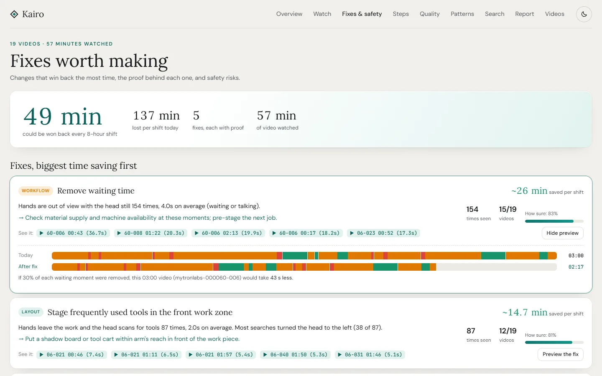
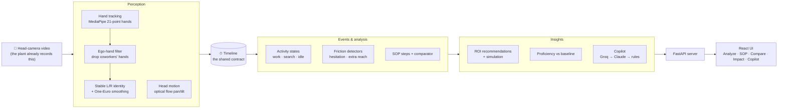
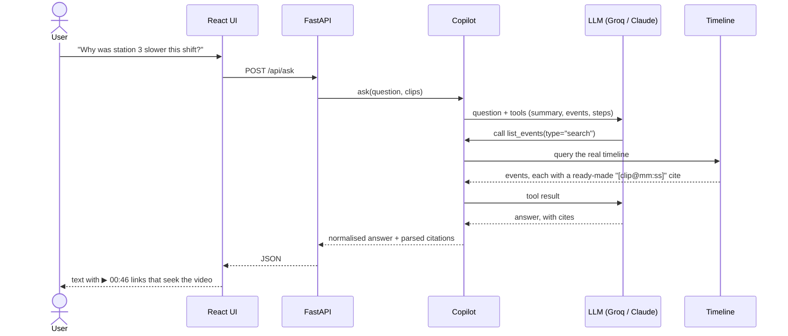
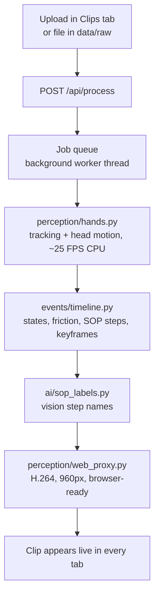

<div align="center">

# Kairo

### AI Process Improvement Copilot

**Instead of evaluating workers, Kairo evaluates the workstation.**

Point it at the head-camera footage a factory already records, and it finds exactly where
every shift loses time — searching for tools, hesitating, walking away, idle waits — then
writes the standard operating procedure, grades new workers against it, and recommends fixes
with a minutes-per-shift number attached. Every claim links to the second of video it came from.

[](tests)
[](requirements.txt)
[](#tech-stack)
[](LICENSE)
[](#problem-statement)

### 🔗 Live: **[kairo-61lz.onrender.com](https://kairo-61lz.onrender.com)**

<sub>Free hosting sleeps when idle, so the first visit can take about a minute to wake up. The dashboard is at <a href="https://kairo-61lz.onrender.com/#/app">/#/app</a>.</sub>

**[Live demo](https://kairo-61lz.onrender.com) · [3-minute demo script](docs/DEMO.md) · [Full technical write-up](docs/OVERVIEW.md) · [Team](#team)**

Built for the **BIOS Hackathon 2026** by team **DefectIQ**.

</div>

---

## Screenshots

| Landing page | Overview |
|---|---|
|  |  |
| **Watch a video** | **Fixes & safety** |
|  |  |

---

## Contents

- [Problem statement](#problem-statement)
- [Does this already exist?](#does-this-already-exist)
- [Our solution](#our-solution)
- [How it works](#how-it-works)
- [Feature list](#feature-list)
- [Tech stack](#tech-stack)
- [Architecture](#architecture)
- [Measured results](#measured-results)
- [Run it locally](#run-it-locally)
- [Deployment](#deployment)
- [Project layout](#project-layout)
- [Testing](#testing)
- [Honest limits and roadmap](#honest-limits-and-roadmap)
- [Future work](#future-work)
- [Team](#team)
- [License](#license)

---

## Problem statement

Factories already record thousands of hours of head-camera (egocentric) video of workers doing
their jobs. Almost none of it gets watched, because nobody has the time:

- An industrial engineer who wants to know **where a station loses time** has to scrub through
  footage by hand, one worker at a time, and guess.
- Writing the **standard operating procedure (SOP)** for a station means timing a worker with a
  stopwatch, over and over, across shifts.
- Checking whether a **new hire follows the SOP** means a supervisor watching them directly —
  which changes how the worker behaves, and still doesn't scale past a handful of people.
- A plant manager asking **"why was this shift slower?"** gets an opinion, not an answer with a
  timestamp attached.

So the footage sits there, the same 20 minutes of friction repeats every shift, and the fix for
it never gets found because nobody can afford to go looking.

> Built for the **Open Innovation** track: an open-ended brief to apply AI to a real
> manufacturing problem, using footage supplied for the event.

## Does this already exist?

Mostly not in this shape. The nearest existing categories, and where Kairo sits relative to them:

| Category | Examples | What it does | Where Kairo differs |
|---|---|---|---|
| **Manual time-and-motion study** | Stopwatch / MTM-style industrial engineering | A human times a worker directly, by hand, for a sample of cycles | Kairo times *every* cycle in the footage, automatically, from video the plant already has |
| **Process mining** | Celonis, UiPath Task Mining | Mines **software event logs** (ERP clicks, system timestamps) to find process bottlenecks | There's no software log on a factory floor — Kairo mines **video**, the only record that actually exists there |
| **Vision-based line monitoring** | Fixed-camera assembly-line analytics (e.g. Drishti-style systems) | Usually a **fixed overhead/side camera** watching a whole line or station from outside | Kairo works from the **worker's own point of view** (egocentric), so it sees hand-level detail a fixed camera misses, and needs no camera installation — it's the footage already being worn |
| **Wearable ergonomics / fatigue tech** | Motion-sensor vests and wristbands | Flags *worker* strain or fatigue from body sensors | Kairo explicitly scores the **workstation**, never the worker, and needs no hardware beyond the camera already in use |
| **Generic AI video summarizers** | General-purpose video-QA tools | Describe what's in a clip in free text | Kairo's answers are **grounded**: an LLM can only query a structured timeline it never hallucinates, and it reports a confidence number only when that number was actually measured |

The honest gap Kairo fills: there was no tool that took the egocentric footage a factory
*already records*, asked nothing new of the floor, and turned it directly into a friction map,
an SOP, a graded comparison, and a cited answer to "why" — on a laptop CPU, with no training data
to collect.

## Our solution

Kairo is a pipeline, not a single model:

1. **Watch** the clip — track both of the wearer's own hands (MediaPipe), and the head's motion.
2. **Turn motion into a timeline** — working, searching, hesitating, idle, each with a start and
   end time.
3. **Find the friction** — every stall, extra reach and wasted search becomes a timestamped event.
4. **Write the SOP** — steps are segmented automatically and named by a vision model, then other
   recordings are compared against them, step by step.
5. **Recommend a fix, with a number** — friction time × a stated recoverable fraction ×
   shift-length extrapolation, with the evidence clips attached and a before/after simulation.
6. **Let you ask it anything** — a copilot that can only query the timeline it was given, so every
   claim is a `[clip@mm:ss]` citation that jumps straight to that second of video.

Nothing here needs new hardware on the floor, a labelled training set, or a GPU. It runs on the
same footage the plant already has, on a laptop CPU, and gives a result in minutes instead of a
manual study that takes days.

## How it works



### How a question gets answered, with proof



If Groq is unreachable, the copilot falls back to Claude, then to a deterministic rules engine —
the citations work identically either way, so the demo never goes blank.

## Feature list

### Core pipeline

| Feature | What it gives you |
|---|---|
| **Friction map** | A colour timeline per clip — green working, red searching/walking away, yellow idle/hesitating. Click any part to jump to that second of video. |
| **Auto-SOP** | Work is split into steps automatically; each gets a keyframe, duration, hand used, and a name + tool written by a vision model. |
| **SOP comparator** | Line a reference clip up against a candidate and list missing, extra, out-of-order and slower steps. |
| **Layout & savings** | Friction time turned into minutes-per-shift, ranked fixes, and a station map of where the worker searches. |
| **Copilot** | Ask in plain English; every answer cites the exact clip and timestamp it came from. |
| **Shift report** | One printable page: KPIs, top fixes, the bottleneck step, friction table, hand-tracking quality — exportable to PDF. |

### Advanced analysis

| Feature | What it gives you |
|---|---|
| **Recommendation engine v2** | Each fix is a full evidence record: observation, stats, a *stated* confidence formula, €/year, supporting clips, and a before/after timeline simulation. |
| **Workflow Proficiency Engine** | Each recording scored 0–100 against its station's own baseline (leave-one-out median, robust z-scores), with a skill-fingerprint radar — it grades the *workflow*, never the person. |
| **Temporal verification** | Hands are accepted from a track over time, not a single frame; short dropouts are bridged only when the motion is consistent, cutting hand flicker 28%. |
| **Smart Quality Score** | 0–100 per recording and per step, with a ✓/⚠/✗ reason behind every point — sequence, tool match, duration vs baseline, idle/search flow. |
| **Motion Skill Profiler** | Unsupervised clustering of recordings into Expert-like / Developing / Beginner-like from motion smoothness, corrections and idle time — describes the motion, not the worker. |
| **Collaboration Intelligence** | A precision-first detector that only flags collaboration when a coworker is close, facing the wearer, and work pauses then resumes — never claims to know what was said. |
| **SOP compliance scoring** | A live, per-clip compliance score against the written SOP, surfaced on demand through `/api/sop-compliance`. |

### Extended capabilities

| Feature | What it gives you |
|---|---|
| **Attention heatmap** | Where on the station the worker's gaze/hands actually concentrate, aggregated across a clip. |
| **Natural-language clip search** | Search across every processed clip by description, not by filename or timestamp. |
| **Digital twin replay** | A station-map replay of a clip's events, built from the real timeline, not a synthetic 3D scene. |
| **Safety risk prediction** | Flags the motion patterns that tend to precede a near-miss, before one happens. |
| **Collaboration score** | A rollup score of collaboration health across a shift, separate from individual event detection. |
| **Behaviour drift / adaptive baseline** | Tracks how a worker's own pattern shifts over time against an adaptive station baseline. |
| **Root-cause analysis** | Traces a slow shift back through the timeline to the one upstream event that actually caused it. |
| **Knowledge graph** | Links stations, steps, tools and recurring friction into a queryable graph across the whole dataset. |
| **Shift memory** | Remembers what's already been reported so a repeat question doesn't repeat the same analysis from scratch. |
| **Training highlight reel** | Auto-cuts the clearest examples of a step into a short clip (`ffmpeg`) for onboarding new hires. |
| **Live safety alert** | An audible + visual on-screen alert the instant a risky motion is detected in a clip being reviewed. |
| **Voice input for the copilot** | Ask the copilot out loud (Web Speech API) — useful anywhere typing isn't convenient. |
| **3D hand skeleton view** | The 2D clip replayed as a depth-aware 3D hand rig, using MediaPipe's own relative-depth signal. |
| **Open-vocabulary tool detection** | Optional SAM 2 / YOLO-World-style tool masks on keyframes — explicitly labelled unvalidated until measured, never shown as a silent confidence number. |

Every number on every screen either came from a measurement stated somewhere in this README, or
it isn't shown at all. That rule has no exceptions — see [Honest limits](#honest-limits-and-roadmap).

## Tech stack

| Layer | Technology | Why |
|---|---|---|
| **Hand tracking** | Google MediaPipe (21-point hand landmarker) | Pretrained, fast enough for CPU-only, no training data needed |
| **Head motion** | OpenCV optical flow | Classical, explainable pan/tilt signal, no model required |
| **Landmark smoothing** | One-Euro filter | Removes jitter without adding lag |
| **Timeline / friction / SOP logic** | Pure Python, calibrated thresholds (`events/`) | Deterministic and auditable — every rule can be stated in one sentence |
| **Step captions** | Qwen vision model via Groq | Reads a keyframe, writes the step name and tool |
| **Copilot** | Groq `gpt-oss-120b` (tool calls) → Claude → rules engine | Automatic fallback chain so a missing API key never breaks the demo |
| **Optional tool detection** | `ultralytics` (SAM 2 / YOLO-World) | Lazy-imported, off by default, clearly labelled unvalidated |
| **API** | FastAPI + Uvicorn | One process, one origin, serves the API and the built frontend together |
| **Frontend** | React 18 + Vite | `@mediapipe/tasks-vision` for in-browser overlays, `lenis` for smooth scroll |
| **Video transcoding** | `imageio-ffmpeg` | H.264 web-playable proxies and the highlight reel |
| **Testing** | `pytest` (149 tests) | End-to-end, contract, AI and unit suites — see [Testing](#testing) |
| **Deployment** | Docker, single container | CPU-only base image, no GPU plan required |

No GPU, no cloud training job, and no proprietary dataset: everything runs from a `pip install`
and an `npm install` on a normal laptop.

## Architecture



```
perception/   hands.py (MediaPipe + L/R identity + One-Euro + metrics), ego_motion.py,
              social.py (people, faces, voice activity), tools.py, verify.py, web_proxy.py
events/       timeline.py, insights.py, recommend.py, proficiency.py, quality.py,
              skill_profile.py, collaboration.py, compare.py, sop.py, attention.py, search.py,
              digital_twin.py, safety.py, collab_score.py, baseline_drift.py, root_cause.py,
              knowledge_graph.py, memory.py, shift_summary.py, pdf_report.py, highlight_reel.py,
              tool_mask.py, apply_tools.py, config.py
ai/           copilot.py (Groq → Claude → rules), sop_labels.py, recaption.py, env.py
server/       app.py — every /api/* route, one FastAPI app, serves the built frontend too
web/          React + Vite UI: Analyze · SOP · Compare · Impact · Proficiency · Quality ·
              Skill Profile · Search · Copilot · Shift Report · Clips
tests/        149 integration + unit tests (python -m pytest tests -q)
schema/       the timeline contract + a mock timeline for tests
pipeline.py   runs the whole pipeline for one or more clips
```

## Measured results

Every number below is from [docs/OVERVIEW.md](docs/OVERVIEW.md) and [docs/TESTING.md](docs/TESTING.md),
measured on footage **never used while tuning the detectors** — the honest number, not the best one.

| Measure | Before tuning | After tuning (tuning clips) | **Held-out clips (unseen)** |
|---|---:|---:|---:|
| Hand-tracking precision | 92% | 91% | **91%** |
| Hand-tracking recall | 46% | 57% | **59%** |
| Left / right hand identity accuracy | 47% | 78% | **93%** |
| Jitter removed by One-Euro smoothing | – | ~40% | ~35% |

- **Speed:** ~20–25 FPS on a laptop CPU (640px, every 2nd frame) — no GPU anywhere in the pipeline.
- **Data:** 19 clips (57 minutes) processed from the hackathon dataset; 90 frames / 15 clips hand-labelled
  for tuning, 48 frames / 3 clips held out and never looked at until the final measurement.
- **Automated tests:** 149 passing (`python -m pytest tests -q`) — end-to-end, timeline contracts,
  AI grounding, and unit coverage. See [Testing](#testing).

Shift-savings estimates are **linear extrapolations** from observed friction seconds and always say so
on screen — Kairo would rather show a smaller, defensible number than an impressive, made-up one.

## Run it locally

**Prerequisites:** Python 3.12+, Node 18+, `git`. No GPU, no CUDA — everything below runs on a
normal laptop CPU.

```bash
git clone https://github.com/goyalnishtha841/kairo.git
cd kairo
```

**1. Install dependencies**

```bash
python -m venv .venv && source .venv/bin/activate   # Windows: .venv\Scripts\activate
pip install -r requirements.txt
npm --prefix web install && npm --prefix web run build
```

**2. Configure (optional)**

```bash
cp .env.example .env         # add GROQ_API_KEY and/or ANTHROPIC_API_KEY
```

Both keys are optional — with neither set, the copilot still runs on the deterministic rules
engine, with the same citations. `.env` is git-ignored and never committed.

**3. Get footage to process**

Kairo ships with no video (see [Data rules](#data-rules)). Either:

- drop your own clips into `data/raw/`, or
- pull the event's demo footage: `python -m gdown --folder "<drive folder url>" -O data/raw --continue`

**4. Process clips and start the app**

```bash
python pipeline.py --all --skip-existing           # builds hands.json, timeline.json, web.mp4, etc.
python -m uvicorn server.app:app --port 8000       # open http://localhost:8000 in a browser
```

**5. Run the tests (optional, confirms everything installed correctly)**

```bash
python -m pytest tests -q                          # 149 tests
```

For frontend development with hot reload instead of the built bundle:

```bash
python -m uvicorn server.app:app --port 8000
npm --prefix web run dev                           # http://localhost:5173
```

## Deployment

One container, one process: FastAPI serves the API and the built frontend from the same origin —
no CORS to configure, no GPU plan to pay for.

```bash
docker build -t kairo .
docker run -p 8000:8000 --env-file .env kairo       # GROQ_API_KEY / ANTHROPIC_API_KEY are optional
```

On [Render](https://render.com): **New → Blueprint → pick this repo** (`render.yaml` is already
set up, health check on `/api/engine`). Any Docker-capable host — Railway, Fly.io, a plain VM —
works the same way: build the `Dockerfile`, run it, point it at a persistent disk for `outputs/`
if processed clips should survive a restart.

The deploy image installs `requirements-deploy.txt`, not `requirements.txt`: it skips
`ultralytics` (pulls in `torch`, several hundred MB) since the optional tool detector and SAM 2
masks it powers are lazy-imported and off until a station's `STATION_TOOLS` is configured anyway.
Deploying somewhere with the headroom for that too is just `pip install ultralytics` on top.

### AI engines (picked automatically: Groq → Claude → rules)

| Engine | Used for | Needs |
|---|---|---|
| **Groq** | Copilot on `gpt-oss-120b` with tool calls over the timeline; step names + tools on keyframes with a Qwen vision model | `GROQ_API_KEY` |
| **Claude** | Same copilot tools, used when Groq isn't configured | `ANTHROPIC_API_KEY` |
| **Rules** | Deterministic, fully offline fallback — always cites real timestamps | nothing |

The LLM never sees raw video — it only ever queries the event timeline, and every moment it
mentions is a `[clip@mm:ss]` citation the UI turns into a seek link. That's true whichever engine
answered.

## Project layout

See [Architecture](#architecture) above for the full module map. The short version: `perception/`
turns video into landmarks, `events/` turns landmarks into a timeline and every downstream
analysis, `ai/` is the only place that talks to an LLM, `server/` is one FastAPI app exposing all
of it, and `web/` is the single-page UI that consumes it.

## Testing

```bash
python -m pytest tests -q
```

| Suite | What it proves | Tests |
|---|---|---|
| **End-to-end** (`test_e2e.py`) | Cuts a real clip and runs the full pipeline; checks every artifact exists, hand-tracking meets its quality bars, the web video is playable, and the API + UI serve the result — including a real upload through the background worker | 8 |
| **Contracts** (`test_contracts.py`) | Across every processed clip: valid event types/bounds, contiguous states, ordered steps, insights math (breakdown sums to 100%, evidence points at real events, shift extrapolation scales correctly) | 59 |
| **AI** (`test_ai.py`) | The rules copilot answers with citations that point at real clips/times; live Groq answers are checked for grounding; the comparator catches a missing step, a swapped order and a slower step on a synthetic case | 12 |
| **Units** (`test_units.py`) | Hand identity survives label flips; the ego-hand threshold works; One-Euro reduces jitter without lag; the API rejects path traversal, unknown clips and non-video uploads | 8 |

## Honest limits and roadmap

- Shift savings are **linear extrapolations** from observed friction, and the UI says so.
- "Idle" means hands out of view with the head still — that can include talking or watching a
  machine, so it's always labelled *idle / waiting*, never "lazy".
- Head-turn angles are rough on a fisheye lens, so the UI words them loosely.
- The SOP comparator needs two clips of the **same task** — consecutive chunks of one long job are
  different tasks, and low adherence between them is the *correct* result, not a bug.
- Tool identity currently comes from vision captions on keyframes, not a dedicated detector; the
  optional SAM 2 / YOLO-World path is explicitly labelled unvalidated until it's measured the same
  way hand-tracking was.
- Everything runs on a laptop CPU today — no GPU was used anywhere in building or running this.

## Future work

- **Live camera streams:** analyse a shift as it happens, not only after upload, and alert a supervisor while the problem is still on the floor.
- **Measured tool detection:** label tool footage and measure the SAM 2 / YOLO-World tool path the same way hand tracking is measured, then turn it on by default.
- **Persistent storage for uploads:** keep every uploaded video and its results across restarts (a cloud disk or object storage), with per-factory accounts.
- **Before-and-after proof:** record a station again after a fix and show the minutes actually won back, not just the estimate.
- **Multi-station view:** follow one product through several stations to find the true bottleneck of a line.
- **SOP from the best run:** turn the cleanest recording into a printable, picture-by-picture work instruction automatically.
- **More languages for the copilot and reports**, for shop floors where English isn't the first language.
- **Edge box deployment:** a small on-site box so video never leaves the factory at all.

## Data rules

- Raw footage and `outputs/` stay git-ignored. The processed sample recordings used by the live site are published as a [GitHub Release](https://github.com/goyalnishtha841/kairo/releases) file (with the organisers' permission) and baked into the deploy image by the `Dockerfile`.
- The screenshots above come from those same published sample recordings.

## Team

Built for the **BIOS Hackathon 2026** by **DefectIQ**.

| Member | Area |
|---|---|
| **Nishtha Goyal** (team lead) | Advanced analysis and AI features: SOP compliance, attention map, safety risk and live safety alerts, baseline drift, root cause, knowledge graph, shift memory, shift summary and natural-language search; voice input and spoken answers for the copilot; training highlight reels; 3D hand view; tool detection and SAM 2 masks; repeated pick-up detection; PDF report; Docker and Render deployment; README |
| **Noor Tandon** | Core pipeline: hand tracking and temporal verification, the event timeline, SOP comparator, recommendations with time savings, workflow proficiency, collaboration detection, skill profiling and quality score; the Groq / Claude / rules copilot; accuracy evaluation and tests; landing page with live hand tracking, dashboard design, dark mode; sample data for the live site |
| **Samyak Rawat** | Research and validation: hand-labelling frames for the accuracy evaluation, testing on the sample recordings, demo script, presentation and demo video |

## License

[MIT](LICENSE) © 2026 Team DefectIQ (Nishtha Goyal, Noor Tandon, Samyak Rawat).

---

<div align="center">
<sub>Kairo scores the workstation, not the person.</sub>
</div>
