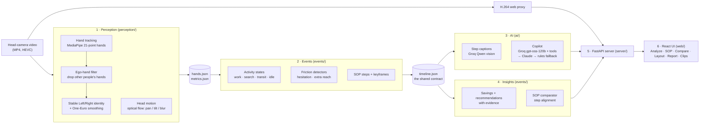
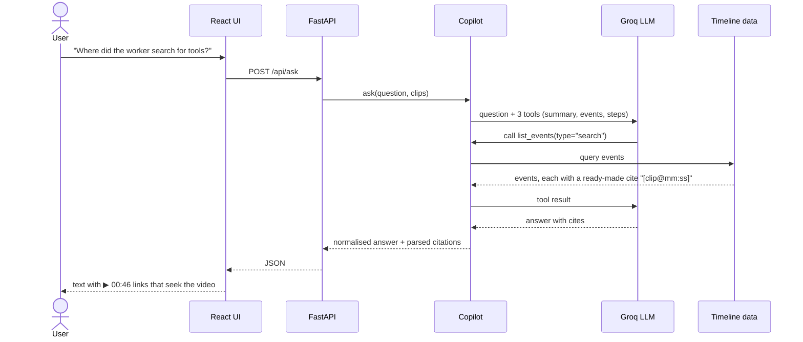
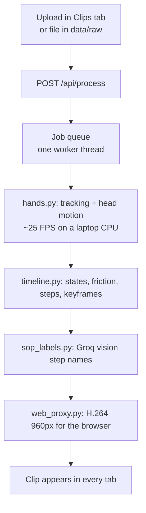

# Kairo: project overview

## 1. The problem (in simple words)

Factories record a lot of video from cameras worn on workers' heads. Nobody has time to watch it.
So nobody really knows:

- where time is lost at a workstation (looking for tools, walking away, waiting),
- which steps take longest and why,
- whether a new worker follows the standard steps (the SOP),
- how the workstation layout should change to save time.

Today an industrial engineer has to watch hours of footage by hand to answer these questions.

**Kairo watches the video for them.** It tracks the worker's hands, notices when work stops and why,
writes the step-by-step SOP, compares other workers against it, and turns all of it into
recommendations with a time saving attached, for example *"stage tools in front of the worker, saving
about 33 min per 8-hour shift"*. Every claim links to the exact moment in the video.

**Kairo scores the workstation, not the person.** It reports friction at a station and what to change
there. It never ranks or scores individual workers.

## 2. What it does: six modules

| # | Module | What it gives you | Where |
|---|---|---|---|
| 1 | **Friction map** | A colour timeline of every clip: green = working, red = searching / walking away, yellow = idle or hesitating. Click any part to jump to it. | Analyze tab |
| 2 | **Auto SOP** | Work is split into steps automatically. Each step gets a keyframe, duration, hand used, and a name + tool written by a vision model ("Cut wood piece · jigsaw"). | SOP tab |
| 3 | **SOP comparator** | Pick a reference clip and a clip to check. Kairo lines the steps up and lists missing, extra, out-of-order and slower steps, plus extra searching/idle time. | Compare tab |
| 4 | **Layout & savings** | Turns friction into minutes per shift, ranks fixes, shows where the worker searches on a station map, and links each recommendation to its evidence clips. | Layout & Savings tab |
| 5 | **Copilot** | Ask in plain English ("Why is this station slow?"). The LLM can only query the timeline, so answers are grounded, and every moment it mentions is a clickable video link. | Analyze tab, right side |
| 6 | **Shift report** | One printable page: KPIs, top fixes, the bottleneck step, friction table, and hand-tracking quality. | Shift Report tab |

Plus a **Clips** tab where you can upload a new video or process downloaded clips and watch the job status.

Added in the principal-engineer round (see [STRATEGY.md](STRATEGY.md)):

| Module | What it gives you | Where |
|---|---|---|
| **Recommendation engine v2** | Each fix is an evidence record: observation, evidence statistics, confidence (the formula is shown), minutes per shift, **EUR per year**, supporting clips, and a **before/after simulation** of the timeline with that waste removed. | Impact tab |
| **Workflow Proficiency Engine** | Each recording is compared with its station's baseline (leave-one-out median, robust z-scores) and gets an explainable 0-100 score, a skill fingerprint radar, and a score across recordings. It describes the workflow, never a person. | Proficiency tab |
| **Temporal Verification** | A hand is accepted from its track over time, not from one frame. Dropouts up to 0.6 s are bridged when the motion is consistent (the hand reappears where it was heading, at the same size, and both sides have at least two detections); isolated one-frame detections below 70% confidence are rejected. Hand flicker drops 28%; on held-out human labels recall rises from 40% to 49% with precision 88% to 90%. All timelines are built from verified tracks; hesitations need the hand to be measured through the stall (81 of the old hesitations were mostly tracking dropouts; 8 remain). Bridged frames count as presence only, never as motion evidence. | Shift Report |
| **Motion Skill Profiler** | Learns, without labels, what practised hand motion looks like at each station: trajectory smoothness (SPARC), hand speed, corrections (sub-movements), repeated grasps, motion entropy, idle time and looking around, with head motion subtracted from the hand tracks. Recordings are clustered into Expert-like / Developing / Beginner-like, each with an expertise index, a motion fingerprint and timestamped evidence. It describes the motion in a recording, never a person. | Skill Profile tab |
| **Collaboration Intelligence** | A precision-first detector of collaboration events from a coworker being close and facing the wearer, voice activity, and a pause in work. It never claims what was said. | Analyze timeline (blue), Shift Report |

## 3. Architecture



### How one question is answered (copilot)



If Groq is down, the copilot falls back to Claude (if configured), then to a deterministic rules engine,
so the demo never breaks.

### Processing a new clip



## 4. How detection works

| What | How it's detected |
|---|---|
| **Own hands only** | MediaPipe finds hands, then the ego-hand filter drops any hand whose palm is smaller than 3.3% of the frame width. Those belong to coworkers further away. |
| **Left vs right** | MediaPipe assumes a mirrored selfie image, so labels are flipped back for a head camera. Then position continuity wins over the label, so hands don't swap identity. |
| **Smooth landmarks** | One-Euro filter: strong smoothing when the hand is still, little lag when it moves (27–39% less jitter measured). |
| **Working** | At least one of the worker's own hands is in view. |
| **Searching** | Hands out of view **and** the head is scanning (camera pan/tilt from optical flow), for under 8 s. |
| **Walking away** | The same, for longer than 8 s. |
| **Idle / waiting** | Hands out of view and head still. |
| **Hesitation** | Hand stalls for 1–3 s between two movements. |
| **Extra reach** | One hand movement whose path is more than 3× the straight line. |
| **SOP steps** | Work blocks separated by gaps of at least 1.5 s; keyframe from the middle of the block. |
| **Savings** | Friction seconds × the fraction a fix can remove (stated on screen) × extrapolation to a shift. |

## 5. Hand-tracking quality (scored by the judges)

Measured with frames labelled by hand (`eval/accuracy.py`). The Shift Report shows these numbers.

| Measure | Before tuning | After tuning (tuning clips) | **Unseen clips (held-out)** |
|---|---|---|---|
| Precision | 92% | 91% | **91%** (whole-video estimate) |
| Recall | 46% | 57% | **59%** (whole-video estimate) |
| Left / right correct | 47% | 78% | **93%** |
| Jitter removed by One-Euro | – | ~40% | ~35% |

- **Tuning set:** 90 frames from 15 clips. We used it to choose the detection threshold and the left/right rule.
- **Held-out set:** 48 frames from 3 clips we never looked at while tuning. That's the honest number.
- **Speed:** about 20 FPS on a laptop CPU (640 px, every 2nd frame), with no GPU.
- **Other people's hands:** about 300 detections per clip are rejected by the ego-hand filter.
- **Remaining misses:** very close-up hands (at the grinder) and hands cut off at the top or bottom edge of the fisheye frame.

## 6. What we tested (140 automated tests, all passing)

Run them with `python -m pytest tests -q`.

| Suite | What it proves | Tests |
|---|---|---|
| **End-to-end** (`test_e2e.py`) | Cuts a real 25 s clip and runs the full pipeline. Checks that every artifact exists and that hand tracking meets quality bars (confidence, smoothing, FPS). Checks the landmarks are valid, the web video is H.264 and playable, the keyframes exist, the API serves the new clip (timeline, hands, video range requests, report, copilot), and the UI is served. It also **uploads a video through the API and waits for the background worker** to finish it. | 8 |
| **Contracts** (`test_contracts.py`) | For every processed clip (19 clips): valid event types and time bounds, unique ids, states that are contiguous and cover the clip, ordered steps. Insights math: the breakdown sums to 100%, lost ≥ recoverable, recommendations are sorted, **every piece of evidence points at a real event**, and shift extrapolation scales correctly. | 59 |
| **AI** (`test_ai.py`) | The rules copilot answers 6 question types with citations that point at real clips and times. Citation clean-up handles odd LLM output. **Live Groq answers are grounded** (citations valid). Comparing a clip with itself gives 100%. On a synthetic case, the comparator **catches a missing step, a swapped order and a slower step**. | 12 |
| **Units** (`test_units.py`) | Hand identity survives label flips. The label wins after a long gap. The ego-hand threshold works. One-Euro reduces jitter without lag. Head-motion direction is correct. The API rejects path traversal, unknown clips and non-video uploads. | 8 |

Bugs these tests caught and we fixed: a copilot regression where a field was renamed, and a crash in the
UI chat. Other bugs found by testing in the browser: coworkers' hands being counted as work, links that
didn't seek across tabs, and motion thresholds set too high.

## 7. How to run

```bash
pip install -r requirements.txt
npm --prefix web install && npm --prefix web run build
cp .env.example .env               # add GROQ_API_KEY
python pipeline.py --all --skip-existing
python -m uvicorn server.app:app --port 8000     # open http://localhost:8000
python -m pytest tests -q
```

## 8. Honest limits / next steps

- Shift savings are **linear extrapolations** from the minutes observed, and the UI says so.
- "Idle" means hands out of view with the head still. That can include talking or watching a machine, so it is labelled *idle / waiting*, not "lazy".
- Head-turn angles are rough on a fisheye lens, so the UI words them loosely.
- The comparator needs two clips of the **same task** (two cycles or two workers). Consecutive chunks of one long job are different tasks and will show low adherence, which is the correct result.
- Tool identity comes from vision captions on keyframes, not a dedicated detector. YOLO-World would be the next upgrade.
- No GPU used; everything runs on a laptop.
